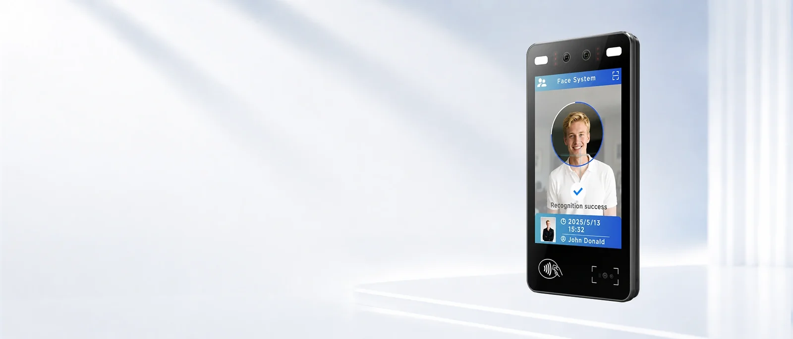
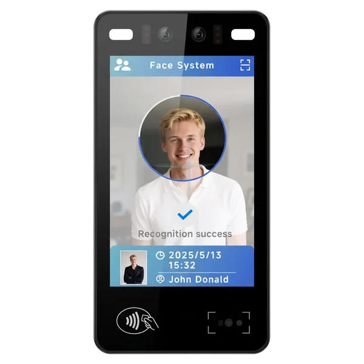
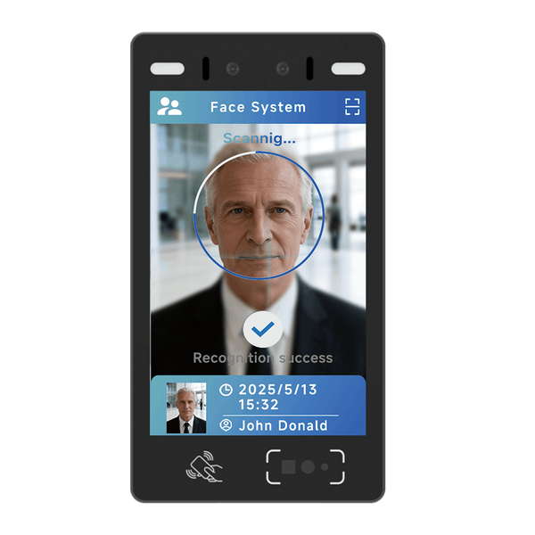
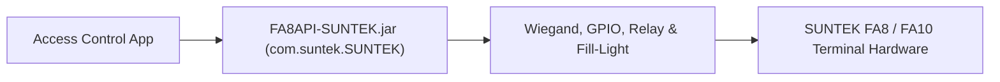

<div align="center">
  <a href="https://www.suntekai.com">
    <picture>
      <source media="(prefers-color-scheme: dark)" srcset="https://raw.githubusercontent.com/SUNTEK-Official/.github/main/profile/assets/logo-dark.png">
      <source media="(prefers-color-scheme: light)" srcset="https://raw.githubusercontent.com/SUNTEK-Official/.github/main/profile/assets/logo-light.png">
      
    </picture>
  </a>

  <h1>SUNTEK FA8 / FA10 Biometric Access Terminal SDK</h1>

  <p>
    <strong>Official Hardware SDK &amp; Developer Kit</strong> &middot; <em>Enjoy Smarter Service</em><br>
    Official Android system, Wiegand access, GPIO, NFC, and fill-light SDK shared by <strong>FA8</strong> and <strong>FA10</strong> biometric access terminals from <strong>SUNTEK Technology Co., Ltd.</strong>
  </p>

  <p>
    <a href="./LICENSE"></a>
    <a href="https://github.com/SUNTEK-Official/suntek-sdk-fa8-fa10/releases"></a>
    
    <a href="https://www.suntekai.com/products/suntek-facial-recognition-biometric-machine-fa8/"></a>
    <a href="mailto:support@suntekai.com"></a>
  </p>

  <p>
    <a href="#hardware-showcase--compatibility">Hardware</a> &nbsp;&bull;&nbsp;
    <a href="#architecture--key-capabilities">Architecture</a> &nbsp;&bull;&nbsp;
    <a href="#supported-interfaces--physical-connections">Interfaces</a> &nbsp;&bull;&nbsp;
    <a href="#5-minute-quick-start">Quick Start</a> &nbsp;&bull;&nbsp;
    <a href="#sample-apps--prebuilt-downloads">Downloads</a> &nbsp;&bull;&nbsp;
    <a href="#troubleshooting--faq">FAQ</a> &nbsp;&bull;&nbsp;
    <a href="#documentation-changelog--support">Support</a>
  </p>
  
</div>

---

## Hardware Showcase & Compatibility

<table>
  <tr>
    <td align="center" width="50%">
      <a href="https://www.suntekai.com/products/suntek-facial-recognition-biometric-machine-fa8/">
        
      </a>
      <br>
      <strong>FA8</strong><br>
      <sub>Facial Recognition Terminal</sub><br>
      <a href="https://www.suntekai.com/products/suntek-facial-recognition-biometric-machine-fa8/">Official Product Page</a>
    </td>
    <td align="center" width="50%">
      <a href="https://www.suntekai.com/products/suntek-face-recognition-terminal-fa10/">
        
      </a>
      <br>
      <strong>FA10</strong><br>
      <sub>10.1-inch Facial Terminal</sub><br>
      <a href="https://www.suntekai.com/products/suntek-face-recognition-terminal-fa10/">Official Product Page</a>
    </td>
  </tr>
</table>

| Product Model | Chipset / Board | OS Versions | Build Identifier | Status |
| :--- | :--- | :--- | :--- | :---: |
| **FA8** | ARM Embedded Platform | Android 11 - 14 | `FA8*` | Supported |
| **FA10** | ARM Embedded Platform | Android 11 - 14 | `FA10*` | Supported |

> [!IMPORTANT]
> Verify your device **Model** and **Build Number** under Android **Settings -> About device** before integration. Customer applications use your own Google Play or enterprise release certificate.

---

## Architecture & Key Capabilities

- **Unified Access & Illumination API**: `FA8API-SUNTEK.jar` (`com.suntek.SUNTEK`) controls fill-light LEDs, Wiegand relays, GPIO triggers, and device properties.
- **On-Device Biometric Privacy**: Local-only hardware access-control APIs designed for GDPR and Illinois BIPA deployments.
- **Complete Sample App**: Runnable `FA8Application` Android project (`com.suntek.fa8application`, `compileSdk 36`) bundled inside `sample-android/`.



---

## Supported Interfaces & Physical Connections

| Hardware Feature | Interface Type | Device Path / Service Target | Notes |
| :--- | :--- | :--- | :--- |
| **SUNTEK System JAR** | Java API (`com.suntek.SUNTEK`) | `FA8API-SUNTEK.jar` | Device model, SN, MAC/IMEI, GPIO, Wiegand, fill-light |
| **Legacy SdkApi Compatibility** | Binder Service (`com.sdkapi`) | `SdkApiJar_V1.250915.0914.aar` | Legacy board compatibility on earlier FA8 batches |
| **Fill-Light & LED** | System Service & Serial HEX | `SUNTEK.Light / /dev/ttyS*` | White/IR LED control (see `docs/LED-Communication-Command.pdf`) |

---

## Repository Directory Layout

```text
suntek-sdk-fa8-fa10/
├── assets/                 # Hero banner & FA8/FA10 photos
├── sdk/
│   ├── FA8API-SUNTEK.jar
│   └── SdkApiJar_V1.250915.0914.aar
├── docs/
│   ├── fa8-fa10-api-reference.md
│   └── LED-Communication-Command.pdf
├── sample-android/         # Android NFC, IR & fill-light demo (com.suntek.fa8application)
├── README.md
├── LICENSE
├── THIRD_PARTY_NOTICES.md
└── CHANGELOG.md
```

> All installers (`.exe`), compiled sample APKs (`.apk`), and large binary packages (> 5 MB) are hosted on [**GitHub Releases**](https://github.com/SUNTEK-Official/suntek-sdk-fa8-fa10/releases) with `SHA256SUMS.txt`.

---

## Prerequisites & Permissions

- **Platform Target**: `minSdk 24` / `targetSdk 35`
- **App Signing Requirement**: Sign customer applications with your own Google Play or enterprise release certificate. System services bind automatically, and elevated operations support companion `SuntekBridgeService.apk` from GitHub Releases.
- **Required Permissions / Capabilities**: `NFC`, `CAMERA`, hardware GPIO / Wiegand access.
> [!NOTE]
> **Biometric Data & Privacy Notice (GDPR / BIPA Compliance)**: This SDK provides local hardware, illumination, Wiegand, and access-control interfaces. **SUNTEK Technology Co., Ltd.** transmits zero biometric templates or user identifiers to external servers. Integrators deploying terminals in regions subject to **GDPR**, **Illinois BIPA**, or equivalent privacy regulations are responsible for capturing explicit end-user consent in their application layer.


---

## 5-Minute Quick Start

### Step 1: Add Dependency

```gradle
dependencies {
    implementation files('libs/FA8API-SUNTEK.jar')
}
```

### Step 2: Control Fill Light, Query SN & Trigger Relay

```java
import com.suntek.SUNTEK;

SUNTEK api = SUNTEK.getInstance();
String serialNumber = api.getSerialNo();
api.setLight(SUNTEK.Light.WHITE, true);
```

### Build & Run Sample Project

```bash
cd sample-android && ./gradlew assembleDebug
```

---

## Sample Apps & Prebuilt Downloads

Verified prebuilt APKs, offline SDK bundles, and checksum manifests are published on [**GitHub Releases**](https://github.com/SUNTEK-Official/suntek-sdk-fa8-fa10/releases). Verify downloaded archives before production deployment:

```bash
shasum -a 256 -c SHA256SUMS.txt
```

---

## Troubleshooting & FAQ

<details>
<summary><b>Which JAR should new FA8/FA10 projects depend on?</b></summary>
<p>Use `sdk/FA8API-SUNTEK.jar` (`com.suntek.SUNTEK`). Only retain `SdkApiJar` for legacy firmware batches that explicitly require it.</p>
</details>

<details>
<summary><b>What signing certificate is required for FA8 / FA10 apps?</b></summary>
<p>Sign with your own commercial or Google Play release certificate.</p>
</details>

<details>
<summary><b>How do I configure fill-light color and brightness commands?</b></summary>
<p>Use `SUNTEK.Light` methods in `FA8API-SUNTEK.jar` or send HEX UART frames documented in `docs/LED-Communication-Command.pdf`.</p>
</details>

---

## Documentation, Changelog & Support

- **Changelog**: [CHANGELOG.md](./CHANGELOG.md)
- **Developer Documentation Portal**: [suntek-docs](https://github.com/SUNTEK-Official/suntek-docs)
- **Technical Support**: [support@suntekai.com](mailto:support@suntekai.com)
- **Bug Reports**: [Open an Issue](https://github.com/SUNTEK-Official/.github/issues/new/choose)
- **Security Disclosures**: See [SECURITY.md](https://github.com/SUNTEK-Official/.github/blob/main/SECURITY.md) or email [support@suntekai.com](mailto:support@suntekai.com)

---

<div align="center">
  
  <br><br>
  <strong>SUNTEK Technology Co., Ltd.</strong> &mdash; <em>Smart Commercial Terminal Hardware Manufacturer Since 2010</em><br>
  <sub>80+ Export Countries &middot; 5,000,000+ Terminals Shipped &middot; 500+ ODM Projects &middot; ISO 9001 / ISO 14001 / ISO 27001 / CE / RoHS</sub><br>
  <sub><a href="https://www.suntekai.com">www.suntekai.com</a> &middot; Copyright &copy; 2026 SUNTEK Technology Co., Ltd. All rights reserved.</sub>
</div>
